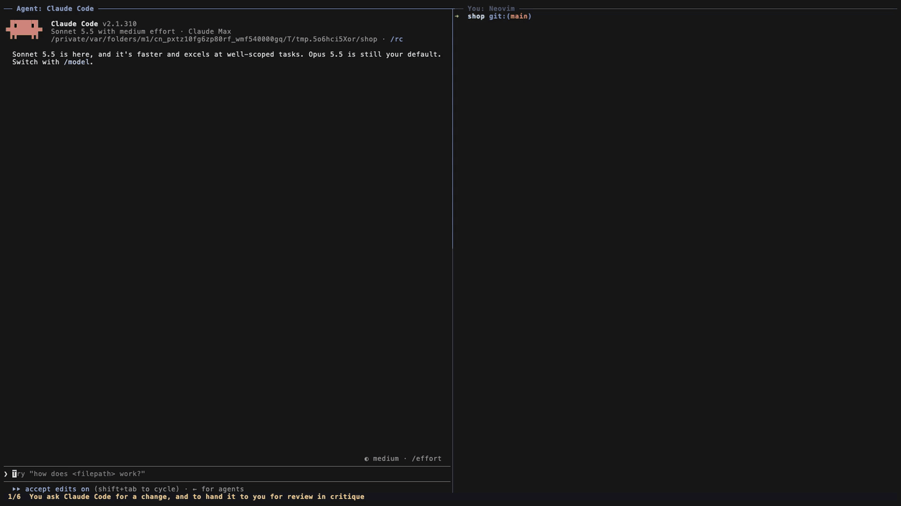

# critique.nvim

**Explore the code while you review it.**

[](https://github.com/BSchrift/critique.nvim/actions/workflows/test.yml)
[](https://github.com/BSchrift/critique.nvim/releases)
[](LICENSE)

Code review in Neovim, for **your AI agent's changes** and for **GitHub pull requests**.



**[▸ Review GitHub pull requests](#review-github-pull-requests)** &nbsp;·&nbsp; **[▸ Review your AI agent's work](#review-your-ai-agents-changes)** &nbsp;·&nbsp; **[▸ New in 0.2](#new-in-02-built-for-the-second-round)**

- **Review your agent's work like a pull request.** The agent hands you its changes as a review.
  You comment on lines in Neovim, the agent answers in the same threads, fixes things, and hands it
  back. It works with Claude Code, Codex, Cursor, and any other agent that can run shell commands.
  Everything stays on your machine.
- **Or go live:** the agent picks up each comment as you save it and starts on it right away.
- **Review GitHub PRs inside a real checkout.** You get a GitHub-style diff on the real files, while
  your LSP, telescope, and `gd` keep working. Comments sync to GitHub as you write them.
- **Suggest by editing.** Change the code right in the file and `:w`. After a preview, your edits become
  suggestions: on GitHub the author commits them with one click, and an agent applies them.
- **Made for the second round.** See only what changed since your last review, tick files off as viewed,
  and step through the open threads.

## New in 0.2: built for the second round


<sub>Demo in full quality: [demo/features.mp4](demo/features.mp4)</sub>

- **Suggest by editing.** Change the code and `:w`. After a preview, your edit is a GitHub suggestion the
  author can commit with one click, or exact code for your agent to apply.
- **`:Critique since`** shows only what changed since your last review.
- **`:Critique viewed`** ticks files off as you go, in sync with GitHub's "Viewed" checkbox.
- **`:Critique threads`** lists every open thread; `]q` / `[q` step through them.
- **`:Critique overview`** shows the description, CI checks, and the conversation.

Everything new is in the [changelog](CHANGELOG.md).

## Features

**In every review**
- GitHub-style diff drawn over the real files: green additions, red deleted lines shown as virtual
  lines, and the changed words inside a line highlighted. The buffer is always the real file, so your
  LSP, telescope, `gd`, grep, and formatters keep working in changed files and the rest of the repo.
- Line numbers you can comment on are tinted gray-blue. `]c` / `[c` jump between changes, and the
  changed files are in the quickfix list.
- Comment on a line or a visual range in a markdown buffer. Read and reply to threads, edit your
  drafts, resolve, delete. Threads show inline at the end of their line, with their number (`#2`).
- `:Critique before` / `:Critique after` switch between the old and new version of a file at the same
  spot, and you can comment on deleted lines there. `:Critique toggle` hides the overlay.
- **Suggest changes by editing the code.** Edit a file and `:w`: a window previews your edits, and `y`
  posts them as suggestions (GitHub's "Commit suggestion" for PRs, or exact code for the agent). Nothing
  is written to disk.
- `:Critique threads` lists the open threads at the bottom (who's waiting on whom, pending, outdated);
  `]q` / `[q` go from one to the next. `:Critique files` switches back to the changed files.
- `:Critique viewed` marks a file viewed (✓ in the file list, with a count) and moves on to the next one.
  A viewed file that changes shows ● until you look again. On GitHub it's the same "Viewed" checkbox
  as on the website.
- `:Critique since` shows only what changed since your last review: new commits since your last GitHub
  review, or what the agent changed since your last submit.
- `:Critique overview` shows what the review is about: the PR's description, checks, and conversation,
  or the agent's submit summaries.
- `:help critique`, `:Critique help`, and `critique -h`.

**Reviewing your AI agent**
- A turn-based loop: the agent submits, you review and submit, the agent fixes and answers, repeat.
  The agent can also review *your* changes.
- **Live mode:** the agent picks up each comment as you save it (after you pause typing), shows ⏳ on the
  thread it's working on, and its replies appear as it writes them. Opt in per review.
- Works with any agent that can run shell commands. A skill teaches Claude Code, Codex, Cursor, and
  others the loop, and the CLI's output is written for agents to read (`--json` too).
- Neovim refreshes and tells you when the agent submits or closes the review. Threads follow their
  code as the agent edits it; if the code is gone, the thread stays put, marked *outdated*.
- Comment on any line of any file, not just the diff. Drafts stay private until you submit.
- Review handles you can paste (`critique <id>`, `#3` to jump to a thread), or just run `critique` in a repo.
- Several agents at once, one worktree each, or limited to paths with `--scope`.
- Everything stays in the repo (`.critique/`, ignored by git). It works offline and inside agent sandboxes.

**Reviewing GitHub pull requests**
- Open any PR link, including links to a file, line, or comment, and critique jumps there.
- Comments go to a pending GitHub review as you save them. Submit as Comment, Approve, or Request changes.
  Each one ends with a small "Made with critique.nvim" link (`footer = false` turns it off).
- Read and reply to other reviewers' threads, and resolve them.
- `:Critique link` copies a permalink to the current line or range.
- Private repos and GitHub Enterprise work through your existing `gh` login, with no extra setup.
- Opening a PR downloads only what the review needs: the PR's commits without the repo's history, and its
  files. A progress line shows each step as git reports it.

## Review GitHub pull requests


<sub>Demo in full quality: [demo/demo.mp4](demo/demo.mp4)</sub>

- **GitHub-style diff over the real files.** Added lines are green, removed lines appear as red
  virtual lines, and changed words are highlighted, using the same hunks as GitHub's Files tab.
  Line numbers you can comment on are tinted gray-blue.
- **Everything else keeps working.** It's a normal checkout, so your LSP, telescope, `gd`,
  grep, and formatters all work as usual, in PR files and in the rest of the repo.
- **Comments sync as you write them.** Each `:w` saves a comment to your pending review on GitHub.
  `:Critique submit` publishes them all at once as Comment, Approve, or Request changes.
- **Full review workflow.** You can read and reply to other reviewers' threads, resolve
  threads, delete your own comments, comment on several lines at once, and comment on deleted lines.
- **Suggest by editing.** Edit the code and `:w`: critique previews your edits and posts them as GitHub
  suggestions, which the author can commit with one click.
- **Re-review fast.** `:Critique since` shows only the commits since your last review,
  `:Critique viewed` ticks files off (in sync with GitHub's "Viewed" checkbox), and `:Critique threads`
  lists the open threads to step through.
- **PR overview.** `:Critique overview` shows the description, checks, review status, and conversation.
- **Before/after.** Switch any file to its pre-PR version at the same spot, or hide the diff
  overlay for a plain view.
- **Share a line.** `:Critique link` copies a permalink to the line you're on.
- **GitHub Enterprise.** Works with self-hosted GitHub. critique takes the host from the PR URL.

```sh
critique https://github.com/owner/repo/pull/123
```

Or from inside Neovim: `:Critique open https://github.com/owner/repo/pull/123`. Any PR link works,
including links to a specific file, line, or comment (`…/pull/123/changes#diff-…R31`,
`…/pull/123#discussion_r…`). critique opens the PR and jumps there.

critique downloads just the PR's commits and files, not the repo's history, and shows git's progress
while it does. On neovim/neovim, a first open takes about 8 seconds and 15 MB, where cloning took about
15 seconds and 70 MB. Later opens only fetch what changed. Then:

1. **Find your way around.** The changed files are in the quickfix list (`:cnext` / `:cprev`), and
   `]c` / `[c` jump between changes in a file. You can open any other file with your usual tools.
   `:Critique viewed` marks a file viewed and takes you to the next one.
2. **Comment.** Put the cursor on a line and run `:Critique comment`. A markdown buffer opens.
   Write below the `▼` line, then `:w` to save the comment to your pending review and `:q` to close.
   For a multi-line comment, select the lines in visual mode first.
   Or just edit the code and `:w`: critique offers your edits as suggestions.
3. **Reply or edit.** Run `:Critique comment` on a line that already has a thread. You'll see
   the whole thread and can reply, or edit your pending comment. `:Critique threads` lists all the
   open threads; `]q` / `[q` step through them.
4. **Look back.** `:Critique before` shows the file as it was before the PR (comment there to
   comment on deleted lines). `:Critique after` comes back.
5. **Share a line.** `:Critique link` copies a permalink to the cursor line (or a visual
   selection) to your clipboard, ready to paste into Slack or a ticket.
6. **Submit.** `:Critique submit` asks for Comment / Approve / Request changes and an optional summary.
7. **Come back.** When the PR has new commits since your review, critique says so when you open it;
   `:Critique since` shows only those. `:Critique overview` shows the description, checks, and conversation.

Until you submit, your comments are a pending review: they're saved on GitHub but only you can see them.
If you quit halfway, run `critique <url>` again and continue where you left off.

## Review your AI agent's changes


<sub>Demo in full quality: [demo/agent.mp4](demo/agent.mp4)</sub>

1. **You ask the agent** for a change and say to hand it to you in critique.
2. **The agent** starts a local review, makes the change, and gives you a command like
   `critique cart-minimum-3f9a`.
3. **You run it.** Neovim opens the agent's changes with the same diff view and comment threads as a
   GitHub PR. Comment on any line, or edit the code and `:w` to suggest exactly what you want
   (`:w!` writes the change yourself). Then `:Critique submit`.
4. **The agent** is waiting for that submit. It reads your threads, fixes the code, replies, resolves
   what it fixed, and submits again. Neovim refreshes and tells you it's your turn. `:Critique since`
   shows only what it changed since your submit, `:Critique threads` what's still open, and
   `:Critique overview` every summary it wrote.
5. **Repeat** until you submit with nothing left open.

It works the other way round too: ask the agent to review *your* changes with critique, and its
comments show up in Neovim. Reviews live in `.critique/` inside the repo, which git ignores, and
never touch GitHub.

### Live reviews: the agent reacts as you comment

Normally the agent waits until you `:Critique submit`. In a **live** review, each comment goes to the
agent when you save it, and it gets to work right away:

- It starts once you've stopped saving comments for about 20 seconds, so related comments arrive together
  and it doesn't act on one you're about to edit. Until then the thread shows `· sent`.
- The thread it's working on shows `⏳ claude is on it`, and Neovim tells you when it replies or resolves.
- Replying to a resolved thread reopens it (even a "thanks", so the agent takes another look).
  `:Critique submit` is optional; use it to say "that's all for now".

**Setup: none beyond the skill.** Ask for it ("…hand it to me for review in critique, live"), or turn
it on yourself in an open review with `:Critique live` (run it again to turn it off). The agent has to be
listening for your comments: Claude Code listens in the background and reacts even mid-task; other agents
react when they finish their current step. If the agent has stopped, tell it "watch my critique comments".

### Set up your agent (once)

First [install critique](#install), including the `critique` command (step 3). Agents talk to it
through that command. Then give your agent the critique skill, which teaches it the review loop:

| Agent | Install the skill |
|---|---|
| **Claude Code** | `mkdir -p ~/.claude/skills && ln -s ~/.local/share/nvim/lazy/critique.nvim/skills/critique ~/.claude/skills/critique` |
| **Codex, Cursor**, and other agents that read `~/.agents/skills` | `mkdir -p ~/.agents/skills && ln -s ~/.local/share/nvim/lazy/critique.nvim/skills/critique ~/.agents/skills/critique` |
| **Any other agent** (Gemini CLI, Aider, …) | Paste [skills/critique/SKILL.md](skills/critique/SKILL.md), without the `---` header, into its instructions file (`AGENTS.md`, `GEMINI.md`, …) |

When the agent commits work you reviewed in critique, the skill has it end the commit message with a
`Developed-with: critique (https://github.com/BSchrift/critique.nvim)` trailer. To leave it out, tell
your agent not to add trailers (in `CLAUDE.md`, `AGENTS.md`, or the like).

Linking instead of copying keeps the skill up to date when the plugin updates. To set it up for one
repo only, link it into that repo's `.claude/skills/` or `.agents/skills/` instead. If your plugin
manager isn't lazy.nvim, adjust the plugin path as in step 3.

### Use it

Ask for a change the way you normally would, and mention critique:

> Make FIVEOFF require a $10 minimum order. Hand it to me for review with critique and iterate on my comments.

> Review my changes on this branch with critique.

You can also use critique without asking the agent first. Run `critique` in a repo to start a review of
your branch's changes, leave comments for the agent, submit, then tell it "address my critique comments".

**Handles.** Each review has an id like `cart-minimum-3f9a`. `critique <id>` opens it from any
directory, `critique <id>#3` jumps to thread #3, and `critique` with no argument opens the one in the
current repo (or lets you pick). `critique ls` lists them. If the agent's sandbox can't write outside
the repo, its handle looks like `<id>@<path>`, which works from anywhere. In zsh with `extendedglob`
set, quote a handle that has `#`: `critique 'cart-minimum-3f9a#3'`.

**Several agents at once.** Give each agent its own git worktree, so each review shows only that
agent's changes. Agents sharing one checkout can limit their review to some paths with
`critique start --scope <path>`.

**For agents (and scripts).** `critique -h` lists the commands: `start`, `submit`, `wait`, `watch`,
`ack`, `list`, `diff`, `reply`, `resolve`, `comment`, and so on. They print plain text meant for agents to read, and
`list`, `show`, and `wait` also print JSON with `--json`. Outside a terminal, `critique` never opens
Neovim, so an agent can't get stuck in it. The [skill](skills/critique/SKILL.md) describes the loop.

## Install

### 1. Requirements

- Neovim **0.11+**
- `git`
- For GitHub PRs only: the [GitHub CLI](https://cli.github.com) (`brew install gh`), logged in with
  `gh auth login`. critique uses gh to fetch PRs, clone private repos, and post comments, so it
  doesn't need its own token. For **GitHub Enterprise Server**, log in to your company's host once:
  `gh auth login --hostname github.yourcompany.com`. The `critique` launcher prompts you to do this
  the first time you open a PR from a new host.

### 2. Install the plugin

[lazy.nvim](https://github.com/folke/lazy.nvim):

```lua
{ 'BSchrift/critique.nvim' }
```

There's no need to lazy-load it: at startup it only defines the `:Critique` command, which adds
a few hundredths of a millisecond. Lazy-loading would also hide `:help critique` until the first `:Critique`.

With Neovim 0.12's built-in plugin manager:

```lua
vim.pack.add({ 'https://github.com/BSchrift/critique.nvim' })
```

Other plugin managers work the same way: add `BSchrift/critique.nvim`. Nothing needs configuring.
To follow tagged releases instead of the latest commit, add `version = '*'` (see the
[changelog](CHANGELOG.md)).

Two options, both on by default:

- `auto_suggest`: `:w` in a review file asks to post your edits as suggestions. Turn it off to have `:w`
  save as usual (`:Critique suggest` still asks), and if you use an auto-save plugin that saves as you
  type; see `:help critique-suggestions`.
- `footer`: comments and review summaries you post on GitHub end with a small "Made with
  [critique.nvim](https://github.com/BSchrift/critique.nvim)" link. critique hides it again when it
  shows comments, so you never edit it.

```lua
{ 'BSchrift/critique.nvim', opts = { auto_suggest = false, footer = false } }
```

### 3. Add the `critique` command

Agents need it, and you can use it to start reviews from your shell. Link it into a directory on your `PATH`:

```sh
ln -s ~/.local/share/nvim/lazy/critique.nvim/bin/critique ~/.local/bin/critique
```

(Adjust the first path if your plugin manager installs somewhere else: for `vim.pack`, it's
`~/.local/share/nvim/site/pack/core/opt/critique.nvim/bin/critique`.) `critique -h` shows everything it does.

Then run `:checkhealth critique`. It checks your Neovim, git, and gh login, that the `critique`
command is the one from this plugin, and whether your agent has the skill.

### 4. Add keymaps (recommended)

critique doesn't set any keymaps other than `]c` / `[c` in changed files. Some suggestions:

```lua
vim.keymap.set({ 'n', 'x' }, '<leader>cc', ':Critique comment<cr>', { desc = 'Critique: comment' })
vim.keymap.set('n', '<leader>cb', function()
  vim.cmd.Critique(vim.api.nvim_buf_get_name(0):match('^critique://') and 'after' or 'before')
end, { desc = 'Critique: before/after' })
vim.keymap.set('n', '<leader>ct', '<cmd>Critique toggle<cr>', { desc = 'Critique: toggle diff' })
vim.keymap.set({ 'n', 'x' }, '<leader>cl', ':Critique link<cr>', { desc = 'Critique: copy link to line' })
vim.keymap.set('n', '<leader>cr', '<cmd>Critique resolve<cr>', { desc = 'Critique: resolve thread' })
vim.keymap.set('n', '<leader>cv', '<cmd>Critique viewed<cr>', { desc = 'Critique: mark file viewed' })
vim.keymap.set('n', '<leader>cq', '<cmd>Critique threads<cr>', { desc = 'Critique: list open threads' })
vim.keymap.set('n', '<leader>cn', '<cmd>Critique since<cr>', { desc = 'Critique: only what changed since my review' })
vim.keymap.set('n', '<leader>co', '<cmd>Critique overview<cr>', { desc = 'Critique: overview' })
vim.keymap.set('n', '<leader>cs', '<cmd>Critique submit<cr>', { desc = 'Critique: submit review' })
```

## Commands

| Command | What it does |
|---|---|
| `:Critique` | With a review open: `:Critique comment`. Otherwise: the help |
| `:Critique open <url or review>` | Open a GitHub PR (jumping to the file, line, or comment a link points at), or a local review by handle. With no argument: the local review in this repo |
| `:Critique comment` | Comment on the cursor line, or open the thread already there |
| `:'<,'>Critique comment` | Multi-line comment on a visual selection (always starts a new thread) |
| `:Critique delete` | Delete one of your comments on the cursor line |
| `:Critique resolve` | Resolve / unresolve the thread on the cursor line |
| `:Critique before` | Show the file as it was before the change, at the matching line |
| `:Critique after` | Back to the changed version of the file |
| `:Critique toggle` | Hide / show the diff overlay |
| `:Critique link` | Copy a GitHub permalink to the cursor line (or a visual selection's lines) |
| `:Critique viewed` | Mark the file viewed (or, in the file list, the file under the cursor) and go to the next one; again to unmark |
| `:Critique since` | Show only what changed since your last review (again: all changes) |
| `:Critique overview` | Description, checks, and conversation (local: the submit summaries) |
| `:Critique suggest` | Preview your unsaved edits in this file and post them as suggestions (what `:w` does by default) |
| `:Critique threads` | List the open threads at the bottom; `]q` / `[q` go through them |
| `:Critique files` | Reopen the changed-files list |
| `:Critique refresh` | Reload comments (and, in a local review, the diff) |
| `:Critique submit` | GitHub: publish your pending review. Local: hand the turn to the agent |
| `:Critique live` | Local: turn live mode on or off (comments go to the agent as you save them) |
| `:Critique help` | Open the help (`:help critique`) |

On GitHub, you can comment only on lines inside a diff hunk: changed lines plus 3 lines of context
around them. Their line numbers are tinted gray-blue. Local reviews have no such limit.

Full documentation is in Neovim: `:help critique` (or `:Critique help`). `critique -h` covers the shell command.

`:Critique link` builds a `https://<host>/<owner>/<repo>/blob/<commit>/<path>#L<n>` permalink.
The host comes from the PR URL, so self-hosted GitHub works without any setup. The link points
at the commit you're looking at: the PR head, or in `:Critique before`, the base commit (and the
file's old path if it was renamed). It works for any file in the repo, not just files in the PR.
The link goes to your system clipboard (`+`) and the unnamed register. If Neovim has no
clipboard provider, it goes to the unnamed register only, so `p` pastes it.

## How it works

- **GitHub PRs:** each repo gets a git repo at `~/.cache/nvim/critique/<host>/<owner>/<repo>/repo.git`
  that holds only the commits reviews need, fetched one at a time without their history (`--depth=1`):
  each PR's head, and the merge base its diff starts from, which GitHub's API reports. File contents
  download as they're needed (a partial clone). Each PR gets a git worktree next to it at
  `.../pr-<number>`. While a PR opens, critique asks GitHub for the PR and fetches its head at the
  same time, and looks up the merge base while the files download. Neovim's working directory is set to that worktree, which is why every
  other tool just works. Reopening a PR fetches new commits and checks out the PR head; if edits saved in the worktree are in
  the way, critique stashes them first and tells you how to get them back. Comments go through
  GitHub's GraphQL API via `gh api graphql`.
- **Local reviews:** a review is an append-only log at `.critique/reviews/<id>.jsonl` in the checkout,
  shared by Neovim and the `critique` command. The diff is the review's base commit (fixed when the
  review starts) against the working tree, including uncommitted and untracked files. Each comment
  stores the code it's on, so threads follow that code as the agent edits; if the code is gone, the
  thread becomes *outdated*. Neovim watches the log and refreshes when the agent submits.
- **Suggestions:** `:w` compares the buffer with the file on disk. Each changed block becomes a comment
  holding a ```` ```suggestion ```` block for the lines it replaces, and those edits are taken back out
  of the buffer. The file is never written.
- **Since your last review:** on GitHub, the diff from the commit your last review was on to the PR
  head. In a local review, `:Critique submit` saves a snapshot of the working tree as git objects
  (through a temporary index, so your staging area and branches are untouched), and `:Critique since`
  diffs it against the files now.
- **Viewed files:** on GitHub, the PR's own viewed state. In a local review, an entry in the review's
  log with a fingerprint of the file's diff, so a later change shows.
- **Both:** the diff is `git diff` with GitHub's settings (3 context lines, rename detection, Myers
  algorithm), so your git config can't change the hunks. Removed lines are drawn as virtual lines,
  so the buffer is always the real file on disk.

## Troubleshooting

| Problem | Fix |
|---|---|
| Something isn't working | Run `:checkhealth critique` first: it checks your setup and says what to fix. |
| `To get started with GitHub CLI, please run: gh auth login` | Run `gh auth login`. The `critique` launcher offers to do this for you. |
| `GitHub only accepts comments on lines inside one diff hunk` | Comment on a changed line or within 3 lines of one. For deleted lines, use `:Critique before`. |
| `save or undo your edits first` | Comments are placed by line number, so the buffer must match the file. `:w` to post your edits as suggestions, or undo (`u`, `:e!`). |
| `:w` doesn't save the file | By design: `:w` in a review offers your edits as suggestions. In a local review, `:w!` writes the file. Set `auto_suggest = false` to make `:w` save as usual. |
| The suggestion window pops up while I type | An auto-save plugin is saving on every change. Set `auto_suggest = false` and use `:Critique suggest`. |
| `:Critique since` says "nothing to compare yet" or "can't fetch" | Local: it compares with your last `:Critique submit`, so submit once first. GitHub: your last review's commit was force-pushed away. |
| critique says your edits were stashed | Edits saved in the PR's checkout were in the way of its new commits. Nothing is lost: run the `git -C … stash pop` from the message to get them back. |
| LSP errors about missing dependencies | The worktree is a fresh checkout. Install the project's dependencies there as you would for any clone. |
| A thread says *outdated* | The code it was on has changed. It stays where that code was; reply or resolve it as usual. |
| `HTTP 401` or `authentication required` for a company host | Run `gh auth login --hostname <your GitHub host>`. |
| `:Critique link` says "no system clipboard" | Neovim found no clipboard tool. The link is in the unnamed register (`p` pastes it). See `:help clipboard`. |
| `no review <id> here` | Run it from inside the repo, or use the `<id>@<path>` form. `critique ls` (in the repo) lists reviews. |
| The agent doesn't use critique | Check the skill is installed for that agent (above), and mention critique in your request. |
| Using too much disk | Delete `~/.cache/nvim/critique` (or one `<host>/<owner>/<repo>` inside it). |

## Customizing colors

The defaults use GitHub's diff colors and pick the light or dark set based on `background`.
To override them, define these highlight groups in your config:

`CritiqueAdd`, `CritiqueAddWord`, `CritiqueAddSign`, `CritiqueDelete`, `CritiqueDeleteWord`,
`CritiqueDeleteSign`, `CritiqueHunk` (tinted line numbers), `CritiqueThread`, `CritiquePending`,
`CritiqueResolved`

## Limits

- GitHub: loads up to 100 review threads per PR, 100 comments per thread, and viewed marks for 100 files.
  The overview shows the last 100 comments and checks.
- Local `:Critique since` snapshots are git objects nothing points to, so `git gc` may delete them after
  about two weeks. Submit again to take a new one.
- In local reviews, a binary file that changes after you mark it viewed keeps its ✓.
- PR checkouts have no history, so `git log` and blame there stop at the PR's head commit. (Repos that
  critique cloned before 0.4 keep their full history.)
- One review is open at a time per Neovim instance.
- Agents sharing one checkout and editing the same file can't have their changes told apart. Use one worktree per agent.

## Development

See [CONTRIBUTING.md](CONTRIBUTING.md). The tests run on every push and pull request, on Linux and
macOS, with Neovim 0.11, the current release, and nightly.

```sh
tests/run.sh               # every test, offline (unit tests, plus the CLI and Neovim UI against temp repos)
tests/run.sh cli local     # just some of them
vhs demo/demo.tape         # re-record the GitHub demo (needs vhs; edit the PR URL first)
vhs demo/agent.tape        # re-record the agent demo (needs vhs and Claude Code)
demo/features-setup.sh     # stage a sandbox PR for the 0.2 demo, then put its URL in demo/features.tape
vhs demo/features.tape     # re-record the 0.2 demo
```

## License

MIT, see [LICENSE](LICENSE).
